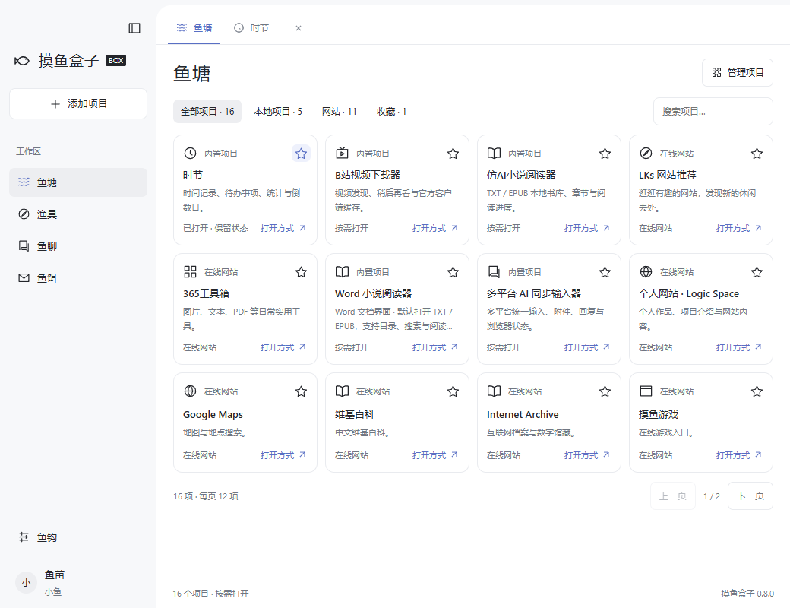

<p align="center"></p>

# 摸鱼盒子

**v0.8.1 · Windows 桌面工具 · 公开测试版**

把常用网站、本地阅读器和桌面工具放进一个带标签页的工作台。通过鱼塘统一管理项目，支持添加自己的网页、电子书和桌面程序。

## 当前功能

- 鱼塘支持项目分类、搜索、收藏和分页；项目卡片和每页数量随窗口大小调整。
- 多标签打开项目，切换时保留状态；各项目使用独立的数据和浏览器目录。
- 添加 HTTPS 网站、本机网页服务、静态 HTML/ZIP 网页包、TXT/EPUB 电子书及外部 EXE。
- 内置时节、Word 小说阅读器、仿 AI 小说阅读器、B站工具和多平台 AI 同步输入器。
- 渔具提供榜单入口；GitHub 今日趋势支持直接展示、刷新、缓存和加入鱼塘。
- 支持浅色/深色主题、窗口自动放大、按项目缩放、托盘运行及诊断日志导出。

## 安装与运行

在 [Releases](https://github.com/Logic-DH-0421/moyu-box/releases/tag/v0.8.1) 下载 `MoyuBox-0.8.1-win-x64.zip`，**完整解压**后运行 `MoyuBox-0.8.1/摸鱼盒子.exe`。

运行环境：Windows x64、.NET Framework 4.8、Microsoft Edge WebView2 Evergreen Runtime。Windows 10/11 为目标平台，当前验证不代表两种系统均已完成独立验收。便携包已包含适配服务，不需要安装 Python、Node.js 或开发工具。请保留同目录 DLL 和资源文件夹。

关闭窗口后程序留在系统托盘；双击托盘图标恢复，通过托盘菜单或设置中的“退出”结束运行。



## 使用步骤

1. 在鱼塘选择内置项目，打开后通过顶部标签切换。
2. 点击侧栏“添加项目”，按类型选择网站、网页包、电子书或桌面程序。
3. 使用卡片星标收藏项目，在鱼塘“收藏”筛选中查看。
4. 在渔具查看 GitHub 趋势或打开其他榜单原站。
5. 在鱼钩设置中调整主题、缩放、窗口行为或导出诊断日志。

外部 EXE 以独立窗口运行，并非通用内嵌。GitHub 源码 ZIP 不一定能直接运行；需要网页入口、构建或适配。项目包格式见 [项目接入规范](docs/plugin-contract.md)。

## 内置项目与边界

| 项目 | 本版快照 | 使用说明 |
|---|---|---|
| 时节桌面版 | 0.11.0 | 时间记录、待办、统计与倒数日 |
| 仿 AI 小说阅读器 | 0.3.14 | TXT/EPUB、本地书库与阅读进度 |
| Word 小说阅读器 | novel-disguise 2.15.0 + 本地适配 | 电子书默认阅读界面；可在设置中切换 |
| B站工具 | 0.7.23 | 依赖官方 PC 客户端完成缓存和播放 |
| 多平台 AI 同步输入器 | 0.14.1 | 各平台的登录和发送按项目原流程处理 |

- 鱼聊尚未连接公共聊天服务。
- 鱼饵目前保存本地反馈草稿；对外反馈请使用 GitHub Issues。
- 其他榜单主要为原站入口，尚未全部实现列表直显。
- 网站功能受网络、地区、账号权限和来源页面变化影响。
- 当前不包含 TikTok 下载器、账户云同步或自动更新。

## 数据与隐私

默认数据目录为 `%LOCALAPPDATA%\MoyuBox`，保存框架配置、收藏、各项目独立数据、浏览器资料和日志。不会自动读取或迁移原独立应用的数据。

- 升级前从托盘完全退出，再备份整个数据目录；解压新版到新的程序目录即可继续使用默认数据。
- 关联外部 EXE 不会复制该程序；退出盒子不会强制结束外部 EXE。
- 浏览器资料可能包含登录状态，分享诊断文件前请检查个人信息。
- 可使用 `摸鱼盒子.exe --data-dir "D:\MyMoyuData"` 指定独立数据目录。

## 开发与构建

需要 Windows x64、.NET Framework 4.8 C# 编译器、Node.js，以及 Python 3.14。源码包含构建所需项目快照，无需原作者电脑上的其他项目目录。

```powershell
python -m venv .venv
.\.venv\Scripts\python.exe -m pip install -r requirements-build.txt
.\build.ps1 -ServicePython .\.venv\Scripts\python.exe -Zip
.\test.ps1
```

运行测试前请激活上述虚拟环境或将其中的 Python 加入 PATH。完整构建需要 PATH 中的 `node`；`-ServicePython` 指定构建所用 Python。`-RefreshIntegrations` 是作者更新本地项目快照的维护选项，普通构建不需要使用。

构建输出：`release/MoyuBox-0.8.1/`。已执行的检查和验证边界见 [VALIDATION.md](VALIDATION.md)，本版变更见 [CHANGELOG.md](CHANGELOG.md)。公开构建脚本移除了作者专用 Python 路径；全新机器完整构建尚待独立验证。

## 反馈

通过 [Issues](https://github.com/Logic-DH-0421/moyu-box/issues) 报告问题时，请提供软件版本、Windows 版本、复现步骤和脱敏后的错误信息。

## 版权与第三方资源

Copyright © 2026 Logic。自有项目代码保留所有权利；本次公开源码不额外授予开源许可证。第三方组件各自遵循其许可，详见 [THIRD-PARTY-NOTICES.md](THIRD-PARTY-NOTICES.md) 和 `licenses/`。

